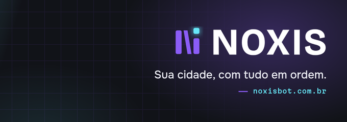

  

<h1 align="center">Noxis Group</h1>

  <b>Ferramentas para quem constrói comunidades de FiveM.</b> 
  <i>Sua cidade, com tudo em ordem.</i>

  <a href="https://noxisbot.com.br/">Site</a> ·
  <a href="https://noxisbot.com.br/patch-notes">Patch notes</a> ·
  <a href="https://noxisbot.com.br/ferramentas">Ferramentas</a> ·
  <a href="https://noxisbot.com.br/termos">Termos</a> ·
  <a href="https://noxisbot.com.br/privacidade">Privacidade</a>

---

A Noxis Group cria o **Noxis**: um bot de Discord com módulos, um painel web e
um conjunto de serviços que tiram do dono de cidade o trabalho repetitivo de
atender, moderar, vender, documentar e organizar a comunidade.

A cidade convida **um único bot**, configura tudo pelo painel e liga só o que
quiser. Tudo roda na nossa infraestrutura: ninguém precisa de VPS, de código
ou de alguém técnico para manter o bot de pé.

## Quem somos

Somos uma equipe brasileira que vive a cena de roleplay em FiveM. O Noxis
nasceu de um problema simples: toda cidade precisa das mesmas coisas (tickets,
whitelist, loja de VIP, logs, regras publicadas, programa de streamers) e
acaba montando isso com vários bots diferentes, planilhas e muita mão de obra
da staff.

A nossa proposta é juntar tudo num lugar só, em português, feito para o jeito
que as cidades brasileiras funcionam.

### O que guia o que fazemos

- **Uma plataforma, não uma colcha de bots.** Um bot, um painel, um login com
  o Discord. Os módulos conversam entre si.
- **A cidade no controle.** Cada função começa desligada e é configurada do
  jeito da cidade. O bot pode usar o nome, a foto e o banner da própria
  cidade, sem aparecer como Noxis.
- **Nada acontece em silêncio.** Toda ação no painel mostra andamento,
  sucesso ou erro, e o que o bot faz fica registrado.
- **Segurança de verdade.** Login pelo Discord, verificação em duas etapas
  (app autenticador ou chave de acesso com Face ID ou digital) para ações
  sensíveis, acesso da equipe por cargo e links públicos que não revelam de
  quem é o arquivo.
- **Transparência.** Termos e Política de Privacidade em português claro e
  patch notes públicos a cada atualização.

## O que o Noxis faz

| | |
| --- | --- |
| 🛡️ **Bot Geral** | Boas-vindas, cargo automático, painel de cargos, moderação, automod, anti-spam contra conta invadida, logs, anúncios, sorteios e sugestões. |
| 🎫 **Tickets** | Abertura por botão ou menu, categorias, status no nome do canal, equipe que assume, transcript e central de atendimento no painel. |
| 🛒 **Loja & VIP** | A cidade vende VIP e itens pelo site, pelo Discord ou no jogo. O dinheiro cai direto na conta dela e a entrega sai sozinha. |
| 🎥 **Programa de Streamers** | Horas de live, nome da cidade no título e presença no servidor conferidos sozinhos, com perfil e ranking. |
| ⚙️ **Automações** | Rotinas "quando X, se Y, então Z" montadas num assistente visual, sem programar. |
| 📚 **Documentação da cidade** | Site próprio com regras, comandos, tutoriais e empregos, com domínio da cidade e HTTPS automático. |
| 🗂️ **Arquivos públicos** | Imagens e arquivos com link rápido para documentação e anúncios, com pastas, tags e acesso por cargo. |
| ✉️ **Editor de mensagens** | Embeds com prévia igual à do Discord, modelos salvos e patch notes da cidade publicados no Discord. |
| 🤖 **Integração com IA** | A cidade conecta a IA que já usa para consultar relatórios e escrever rascunhos de patch notes e documentação. |
| 🧰 **Ferramentas para criadores** | Mesclador de mapas e verificador de roupas e peds, no site e no programa noxis-mapas (Windows e Linux). |
| 📦 **Scripts de FiveM** | Scripts da equipe Noxis com licença por servidor, "Entrar com Noxis" e atualização sem reinstalar. |

## Para onde estamos indo

- **Allowlist completa:** prova no próprio Discord, banco de perguntas com
  sorteio contra cola, correção pela equipe, call de alinhamento e uma IA que
  ajuda a montar a prova a partir dos documentos da cidade.
- **Cidade ↔ Discord:** o apelido no Discord vira o nome do personagem, e
  benefícios por cargo ou por booster são resgatados no jogo.
- **Automações mais poderosas:** novos gatilhos e ações ligados à loja, aos
  tickets e ao servidor FiveM.
- **Parcerias:** vantagens para as cidades que divulgam o Noxis.
- **Mais scripts de FiveM** integrados à plataforma.
- **Noxis Studio:** um programa para criadores abrirem, visualizarem e
  editarem os arquivos do GTA V/FiveM, com conversores e otimizadores.
- **Novos segmentos:** estudamos levar a mesma base para outras comunidades do
  Discord, como mesas de RPG.

Acompanhe o que já saiu em <a href="https://noxisbot.com.br/patch-notes">noxisbot.com.br/patch-notes</a>.

---

© Noxis Group

